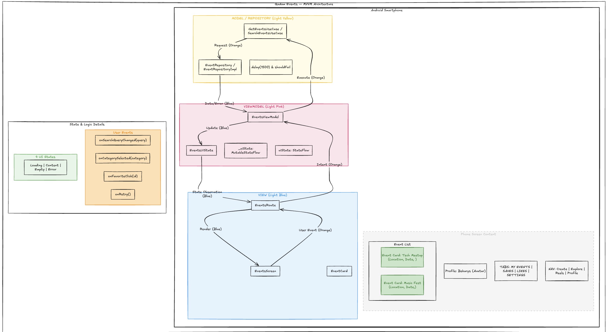

# Qadam Events

Qadam Events is an Android application that centralizes hackathons, IT events, conferences, workshops, and other events in one place. Users can discover, search, filter, register for events, communicate with other participants, and manage their event activity.

## Functionality

- Users can browse a centralized list of hackathons, IT events, conferences, workshops, and other events.
- Users can search and filter events by category, location, date, format, topic, and other criteria.
- Users can open an event and view its details, including description, date, location, organizer, and registration information.
- Users can register for an event and receive a QR code for event check-in.
- Organizers can scan a participant's QR code to confirm their attendance at the event.
- Users can save events to favorites and like, comment on, and share events with other users.
- Registered participants are automatically added to the event's group chat, where they can communicate with other participants and organizers.
- Users can create profiles and publish or view short videos (Reels) related to events and their activities.
- Only verified organizers can create and publish events, and submitted events must pass an internal verification process before publication.
- Organizers can manage their events, view registered participants, control the event group, and check participant attendance.

## Project Structure

```text
QadamEvents/
├── app/
│   ├── src/
│   │   ├── androidTest/
│   │   ├── main/
│   │   │   ├── java/
│   │   │   │   └── com/bekaryab/qadamevents/
│   │   │   │       ├── MainActivity.kt
│   │   │   │       └── ui/theme/
│   │   │   ├── res/
│   │   │   ├── keepRules/
│   │   │   └── AndroidManifest.xml
│   │   └── test/
│   └── build.gradle.kts
├── gradle/
├── build.gradle.kts
├── gradle.properties
├── settings.gradle.kts
├── gradlew
├── gradlew.bat
├── .gitignore
└── README.md

## SIS 4: Refactor Your App to MVVM

This section documents the MVVM refactor of the Events feature. It describes
the real implementation — file names, class names, and function names below
match the source code. The rest of the app (auth, Profile, Explore, Reels,
Create, bottom navigation) keeps its existing architecture and is untouched
by this slice.

### Architecture



A text version of the same diagram lives in
[design/architecture.md](design/architecture.md). Both describe this flow:

```text
EventsScreen → EventsRoute → EventsViewModel → UseCase → EventRepository → data
     ↑              ↑               |
     └────── UiState (StateFlow) ───┘
```

- **View** (`ui/events/list/EventsScreen.kt`): the stateless `EventsScreen`
  composable. It receives an `EventsUiState` plus five callbacks
  (`onSearchQueryChanged`, `onCategorySelected`, `onFavoriteClick`,
  `onRetry`) and only renders. It never touches a ViewModel, repository,
  use case, or filtering logic.
- **Route** (`ui/events/list/EventsRoute.kt`): the thin bridge. It observes
  `viewModel.uiState` with `collectAsStateWithLifecycle()` and forwards state
  plus the ViewModel's real functions into `EventsScreen`. It owns no state.
- **ViewModel** (`ui/events/list/EventsViewModel.kt`): owns screen state in a
  private `MutableStateFlow`, exposed as read-only `StateFlow`. Every update
  goes through `copy()`. It coordinates `GetEventsUseCase` (loading/retry)
  and applies search/category/favorite changes locally for instant response.
- **UiState** (`ui/events/list/EventsUiState.kt`): one immutable data class
  (`allEvents`, `visibleEvents`, `searchQuery`, `selectedCategory`,
  `favoriteEventIds`, `isLoading`, `errorMessage`). Four UI states derive
  from it: Loading (`isLoading`), Error (`errorMessage != null`), Empty
  (no error, empty list), Content (otherwise).
- **Use cases** (`domain/usecase/GetEventsUseCase.kt`,
  `SearchEventsUseCase.kt`, `GetEventDetailsUseCase.kt`): thin suspending
  `operator fun invoke()` pass-throughs to the repository.
- **Repository** (`domain/repository/EventRepository.kt` implemented by
  `data/repository/InMemoryEventRepository.kt`): owns the data. Read
  operations simulate a server with `delay(1500)` and fail when the
  `shouldFail` flag is set; `CancellationException` always propagates.
  Failures surface as `Result.failure`, which the ViewModel turns into the
  Error state. (Note: the older name `EventRepositoryImpl` appears in early
  diagrams; the real class is `InMemoryEventRepository`.)
- **Shared vs slice:** the repository singleton in `di/AppModule.kt` also
  feeds the existing Profile/Explore/Create features through its instant
  `events` flow. The simulated delay/failure path is used only by the SIS 4
  Events flow, so existing screens are unaffected.
- **Rotation:** `EventsViewModel` receives a real `SavedStateHandle` (via
  `EventsViewModelFactory` + `CreationExtras.createSavedStateHandle()`), and
  every query/category/favorite change is written back to it, so the state is
  restored when the ViewModel is recreated.

### Trace one click (search)

Exact path of one search keystroke, verified against the source:

1. `EventsScreen.kt` — the search `OutlinedTextField` calls its
   `onValueChange`, which is the `onSearchQueryChanged` callback parameter.
2. `EventsRoute.kt` — passes `viewModel::onSearchQueryChanged`, so the call
   lands in `EventsViewModel.onSearchQueryChanged(query)` (no logic in any
   composable).
3. `EventsViewModel.kt` — writes the query to `SavedStateHandle`, then
   `_uiState.update { it.copy(searchQuery = query, visibleEvents =
   filterEvents(it.allEvents, query, it.selectedCategory)) }`.
4. `filterEvents()` (same file, pure function, no Android APIs) matches
   title/description/category/location case-insensitively, then applies the
   category equality check.
5. `EventsRoute.kt` — `collectAsStateWithLifecycle()` emits the new
   `EventsUiState` and re-invokes `EventsScreen`, which renders
   `uiState.visibleEvents` in its `LazyColumn` (or the Empty state).

Full narrative version: [design/trace-one-click.md](design/trace-one-click.md).

### Lifecycle and rotation evidence

- The manifest handles no `configChanges`, so rotation destroys and recreates
  `MainActivity` (verified in `app/src/main/AndroidManifest.xml`).
- `MainActivity.kt` logs `onCreate/onStart/onResume/onPause/onStop/onDestroy`
  with tag `MainActivity`; `EventsViewModel` logs `init` and `onCleared()`
  with tag `EventsViewModel`.
- The debug entry (`MainActivity`, `debug_events` intent extra, debug builds
  only) obtains the ViewModel from the Activity's `ViewModelStore`, so the
  same instance survives a normal rotation.
- **Manual observation (emulator, by the student):** after rotating, the
  Activity was destroyed and recreated, while the Events screen kept the
  search query, selected category, and favorite state visible. The captured
  log excerpt showed the `MainActivity` lifecycle sequence with **no new**
  `EventsViewModel` init entry and **no** `onCleared` entry during the
  excerpt. That is consistent with — but no more than — the same ViewModel
  instance surviving rotation. No other runtime claims are made.
- **Reminder — evidence screenshots still to save:** nothing under `design/`
  yet. Before submitting, save (1) the emulator showing the Events Content
  state and (2) the Logcat rotation sequence, e.g. as
  `design/screenshots/events-content.png` and
  `design/screenshots/rotation-logcat.png`, and reference them here.

### Testing

- `./gradlew :app:compileDebugKotlin` — passes.
- `./gradlew :app:testDebugUnitTest` — passes: 7 tests, 0 failures
  (6 × `EventsFilterTest` covering blank query, case-insensitive matching
  across title/description/category/location, category filtering, combined
  query+category, and empty results; plus the pre-existing example test).
  Last verified run: all green.
- The four `@Preview` functions in `EventsScreen.kt`
  (`EventsLoadingPreview`, `EventsContentPreview`, `EventsEmptyPreview`,
  `EventsErrorPreview`) use fake `EventsUiState` objects and no-op lambdas —
  no ViewModel, repository, Firebase, or network. Their *rendering* has not
  been screenshot-verified; they are compile-verified only.